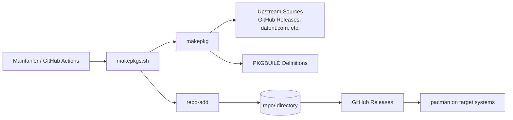
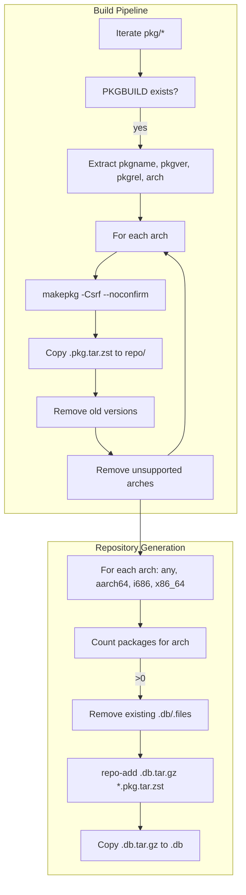
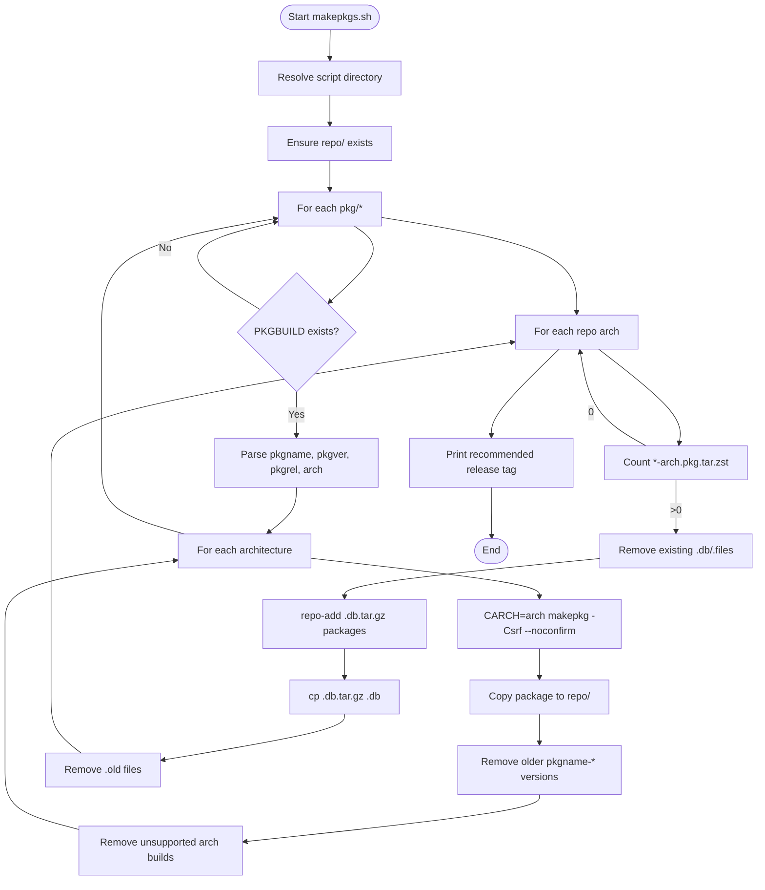
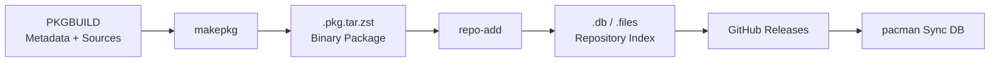
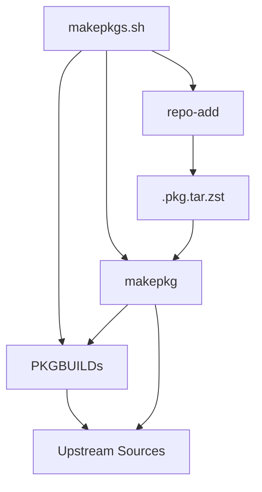

# PKGBUILDs Architecture

This document describes the current architecture of the PKGBUILDs repository, a personal Arch Linux package repository providing custom and unofficial packages via automated build and distribution pipelines.

## 📑 Table of Contents

- [Purpose](#-purpose)
- [System Context](#-system-context)
- [Architectural Style](#-architectural-style)
- [Runtime Flow](#-runtime-flow)
- [Architectural Areas](#-architectural-areas)
- [Data Architecture](#-data-architecture)
- [Interfaces and Integrations](#-interfaces-and-integrations)
- [Dependency Direction and Rules](#-dependency-direction-and-rules)
- [External Dependencies](#-external-dependencies)
- [Deployment and Operations](#-deployment-and-operations)
- [Compatibility Contracts](#-compatibility-contracts)
- [Testing and Verification](#-testing-and-verification)
- [Design Constraints](#-design-constraints)
- [Related Documentation](#-related-documentation)

## 🎯 Purpose

This repository provides a personal Arch Linux package repository containing custom and unofficial packages. The architecture encompasses the build pipeline (`makepkgs.sh`), package definitions (`pkg/*/PKGBUILD`), and the distribution mechanism via GitHub Releases. The intended audience is the repository maintainer and any users consuming the packages via `pacman`. The value of recording these boundaries is to ensure reproducible builds, clear package ownership, and maintainable distribution workflows.

## 🌐 System Context

The system boundary is the `makepkgs.sh` build script and its orchestration of `makepkg` and `repo-add`. Initiating actors are the maintainer (manual execution) and GitHub Actions (automated execution). External systems are the Arch Linux package ecosystem (`makepkg`, `repo-add`, `pacman`), GitHub Releases (artifact hosting), and upstream package sources (GitHub releases, dafont.com, fontles.com, 1001fonts.com, raw.githubusercontent.com). Persistent stores are the local `repo/` directory (built packages and repository databases) and GitHub Releases (published artifacts). Outputs are `.pkg.tar.zst` package files and `.db`/`.files` repository databases. Material trust boundaries exist at the upstream source verification (sha512sums in PKGBUILDs) and the GitHub Release publication step.



The principal external boundaries are:
- **Upstream Sources:** Package source archives and metadata; verified via sha512sums in each PKGBUILD; ownership external
- **Arch Linux Toolchain:** `makepkg`, `repo-add`, `pacman`; build and repository management; ownership external
- **GitHub Releases:** Artifact hosting and distribution; ownership shared (repository maintainer controls publication)
- **Target Systems:** End-user `pacman` consumption; ownership external

## 🏗️ Architectural Style

The repository implements a **build pipeline** architectural style: a linear, script-driven pipeline that transforms source definitions (PKGBUILDs) into built packages and repository databases. The pipeline is orchestrated by a single shell script (`makepkgs.sh`) that iterates over package directories, invokes `makepkg` per architecture, manages artifact retention, and regenerates repository databases with `repo-add`. Principal consequences: simple linear ownership (the script owns the entire flow), no runtime services, all state is filesystem-based, and changes to packages require only PKGBUILD edits.



The principal architecture boundaries are:
- **Package Definitions (`pkg/*/`):** Each package owns its `PKGBUILD`, sources, and build logic; no cross-package dependencies
- **Build Script (`makepkgs.sh`):** Owns orchestration, artifact management, and repository database generation; single entry point
- **Repository Output (`repo/`):** Immutable artifact store for built packages and databases; consumed by GitHub Releases

## 🔄 Runtime Flow



The principal runtime sequence is:
1. **Initialisation:** Resolve script directory, ensure `repo/` directory exists
2. **Package Iteration:** For each `pkg/*` directory containing a `PKGBUILD`, extract metadata (`pkgname`, `pkgver`, `pkgrel`, `arch`)
3. **Per-Architecture Build:** For each declared architecture, invoke `makepkg -Csrf --noconfirm` with `CARCH` set, copy resulting `.pkg.tar.zst` to `repo/`
4. **Artifact Retention:** Remove older versions of the same package; remove builds for architectures no longer declared in `arch=()`
5. **Repository Database Generation:** For each target architecture (`any`, `aarch64`, `i686`, `x86_64`), if packages exist, regenerate `.db` and `.files` databases via `repo-add`
6. **Completion:** Output recommended release tag timestamp

## 🗂️ Architectural Areas

### Package Definitions

Paths:
- `pkg/grub2-theme-nuci/`
- `pkg/hori-fonts/`
- `pkg/image-optimiser/`
- `pkg/plex-video-optimiser/`

Responsibilities:
- Define package metadata (`pkgname`, `pkgver`, `pkgrel`, `pkgdesc`, `arch`, `url`, `license`, `depends`, `optdepends`)
- Declare source URLs and integrity hashes (`source`, `sha512sums`)
- Implement `package()` function to install files into `${pkgdir}`

Boundary rules:
- Each package directory is independent; no shared build logic
- `PKGBUILD` is the sole required file; supplementary files (patches, install scripts) permitted
- Source URLs must be stable and verifiable via `sha512sums`

### Build Orchestration

Paths:
- `makepkgs.sh`

Responsibilities:
- Discover and iterate package directories
- Parse `PKGBUILD` metadata without sourcing the file (uses `grep`/`awk`/`sed`)
- Execute `makepkg` per architecture with clean build flags
- Manage artifact lifecycle in `repo/` (copy, deduplicate, prune)
- Generate per-architecture repository databases via `repo-add`

Boundary rules:
- Single entry point; no external orchestration dependencies
- Does not modify `PKGBUILD` files; reads metadata via text parsing
- Assumes `makepkg` and `repo-add` are available (Arch Linux `base-devel`)

### Repository Output

Paths:
- `repo/`

Responsibilities:
- Store built `.pkg.tar.zst` artifacts
- Store repository databases (`.db`, `.files` and their `.tar.gz` counterparts)
- Serve as the staging area for GitHub Releases upload

Boundary rules:
- Contents are generated exclusively by `makepkgs.sh`; no manual edits
- Artifacts are named `${pkgname}-${pkgver}-${pkgrel}-${arch}.pkg.tar.zst`
- Database naming: `hmlendea.db`/`hmlendea.files` for `any`; `hmlendea-{arch}.db`/`hmlendea-{arch}.files` for others

## 💾 Data Architecture

The system transforms package definitions into built artifacts and repository metadata. Data flows from `PKGBUILD` (source of truth for metadata) through `makepkg` (build-time transformation) to `.pkg.tar.zst` (binary package) and `.db`/`.files` (repository index). No persistent application state exists beyond the filesystem artifacts.



| Data or Store | Owner | Representation and Storage | Lifecycle or Consistency |
|---------------|-------|----------------------------|--------------------------|
| `PKGBUILD` | Package definition (`pkg/*/`) | Bash script with declarative variables and `package()` function | Authoritative; edited manually; version-controlled |
| `source` archives | Upstream providers | Compressed archives (`.zip`, `.sh`, `.ttf`, `.otf`) | Fetched by `makepkg`; verified via `sha512sums`; cached in `src/` |
| `.pkg.tar.zst` | `makepkgs.sh` / `repo/` | Zstandard-compressed tar archive (Arch package format) | Built per architecture; retained until version/arch pruning; published to GitHub Releases |
| `.db` / `.files` | `makepkgs.sh` / `repo/` | Tar.gz archives containing package metadata and file lists | Regenerated on each build run for architectures with packages; published to GitHub Releases |

## 🔌 Interfaces and Integrations

| Interface or Integration | Direction | Contract | Owner | Failure Semantics |
|--------------------------|-----------|----------|-------|-------------------|
| `makepkg` | Outbound | Arch Linux package build protocol; reads `PKGBUILD`, writes `.pkg.tar.zst` | Build Orchestration | Build fails → script continues to next package/arch; error printed to stderr |
| `repo-add` | Outbound | Arch Linux repository database management; reads `.pkg.tar.zst`, writes `.db.tar.gz` | Build Orchestration | Database generation fails → script continues to next architecture; error printed to stderr |
| Upstream Source URLs | Inbound | HTTP/HTTPS GET; stable URLs with immutable content | Package Definitions | Download fails → `makepkg` fails → build fails for that package |
| `sha512sums` verification | Inbound | Cryptographic integrity check of downloaded sources | Package Definitions | Mismatch → `makepkg` fails → build fails for that package |
| GitHub Releases | Outbound | Artifact upload via GitHub Actions / manual `gh release upload` | Deployment | Upload fails → packages not available for `pacman`; manual retry required |
| `pacman` (target systems) | Inbound | Repository sync (`pacman -Syu`) and package install (`pacman -S`) | External | Sync fails → user cannot install/update; typically network or signature issue |

## 🧭 Dependency Direction and Rules



The principal dependency rules are:
- `makepkgs.sh` depends on `PKGBUILD` metadata (read-only text parsing) and on `makepkg`/`repo-add` binaries
- `PKGBUILD` files depend on upstream source availability and integrity
- `makepkg` depends on `PKGBUILD` and downloaded sources; produces `.pkg.tar.zst`
- `repo-add` depends on `.pkg.tar.zst` artifacts; produces `.db`/`.files`
- No reverse dependencies: packages do not depend on the build script; build script does not depend on built artifacts
- Prohibited: `PKGBUILD` files sourcing or invoking `makepkgs.sh`; cross-package `depends` on other local packages (none currently exist)

## 📦 External Dependencies

| Dependency | Responsibility | Integration Boundary | Architectural Consequence |
|------------|----------------|----------------------|---------------------------|
| `makepkg` (pacman package) | Builds packages from `PKGBUILD` | Invoked by `makepkgs.sh` per architecture | Requires Arch Linux `base-devel`; version skew may affect build reproducibility |
| `repo-add` (pacman package) | Generates repository databases | Invoked by `makepkgs.sh` per architecture | Database format tied to `pacman` version; consumers need compatible `pacman` |
| `base-devel` group | Provides build toolchain (gcc, make, etc.) | Implicit dependency of `makepkg` | Must be installed on build host; not declared in PKGBUILDs |
| GitHub Actions / `gh` CLI | Automates build and release publication | External CI/CD; runs `makepkgs.sh` and uploads `repo/` | Enables automated releases; build environment must match target architectures |
| Upstream source hosts (GitHub Releases, dafont.com, fontles.com, 1001fonts.com, raw.githubusercontent.com) | Provide source archives | Referenced in `PKGBUILD.source` | Single points of failure; URL or content changes break builds until `PKGBUILD` updated |

## 🚀 Deployment and Operations

| Concern | Current Design | Architectural Consequence |
|---------|----------------|---------------------------|
| Process topology | Single-script sequential execution on build host | No parallelism; build time scales linearly with package count and architectures |
| Deployment unit | `repo/` directory contents uploaded to GitHub Releases | Atomic per-release; all packages and databases published together |
| Persistent state | `repo/` artifacts and GitHub Releases | Local `repo/` is ephemeral (regenerated each run); GitHub Releases is canonical |
| Filesystem requirements | Write access to `repo/`, `pkg/*/src/`, `pkg/*/pkg/` | Build host needs sufficient disk space for sources, build directories, and packages |
| Network requirements | Outbound HTTPS to upstream sources and GitHub | Build fails offline; GitHub Actions provides network |
| Scaling assumptions | Small package count (currently 4); few architectures (4) | Linear scaling acceptable; no parallel build optimisation needed |
| Startup responsibilities | `makepkgs.sh` ensures `repo/` exists | Idempotent; safe to re-run |
| Shutdown responsibilities | None (script exits) | No cleanup required beyond `makepkg -C` (clean build dirs) |
| Operator-visible outputs | Console logs (build progress, errors, recommended tag) | Maintainer monitors output; GitHub Actions logs captured |

## 🛡️ Compatibility Contracts

| Contract | Owner | Invariant | Verification | Change Policy |
|----------|-------|-----------|--------------|---------------|
| `PKGBUILD` format | Package Definitions | Conforms to Arch Linux `PKGBUILD(5)` specification | `makepkg --verifysource` / `namcap` | Changes follow Arch packaging standards; backward compatibility with `makepkg` |
| Package naming (`${pkgname}-${pkgver}-${pkgrel}-${arch}.pkg.tar.zst`) | Build Orchestration | Matches `repo-add` and `pacman` expectations | `repo-add` succeeds; `pacman -U` installs | Stable; dictated by Arch package format |
| Repository database format (`.db`/`.files`) | Build Orchestration | Compatible with consumer `pacman` version | `pacman -Syu` succeeds on target systems | Tied to `pacman`/`repo-add` version; rebuild databases on toolchain upgrade |
| `sha512sums` integrity | Package Definitions | Matches actual source content | `makepkg` verification step | Updated when upstream sources change; must be regenerated by maintainer |
| GitHub Releases artifact structure | Deployment | `repo/` contents uploaded preserving paths | `pacman` can sync from release URL | Stable; consumers expect consistent URL pattern |

## ✅ Testing and Verification

No automated test suite exists. Verification is manual and operational:

- **Build verification:** Run `bash makepkgs.sh` on Arch Linux with `base-devel`; confirm all packages build without errors and `repo/` contains expected `.pkg.tar.zst` and `.db`/`.files`
- **Install verification:** Add repository to `/etc/pacman.conf`, run `pacman -Syu`, install each package (`pacman -S grub2-theme-nuci hori-fonts image-optimiser plex-video-optimiser`), verify files installed correctly
- **Integrity verification:** `makepkg` verifies `sha512sums` automatically during build; `repo-add` validates package metadata
- **Linting:** `namcap` can be run on built packages to check for packaging issues (not automated)

Execute the principal automated verification with:

```bash
bash makepkgs.sh
```

Material coverage gaps:
- No unit tests for `makepkgs.sh` parsing logic
- No integration tests for multi-architecture builds
- No automated `namcap` linting in pipeline
- No verification of installed package contents beyond manual inspection

## 📐 Design Constraints

- **Single-threaded build:** `makepkgs.sh` processes packages and architectures sequentially; no parallel `makepkg` invocations
- **Arch Linux host required:** `makepkg` and `repo-add` are Arch-specific; cross-compilation not supported (builds run natively per architecture)
- **Upstream source stability:** Builds break if upstream URLs change or content shifts; `sha512sums` pins exact content
- **No cross-package dependencies:** Packages are independent; no local `depends` on other packages in this repository
- **GitHub Releases as sole distribution:** No alternative mirrors or CDN; consumers depend on GitHub availability
- **No signed packages:** `SigLevel = PackageOptional` in `pacman.conf`; packages and databases are unsigned
- **Fixed architecture set:** Only `any`, `aarch64`, `i686`, `x86_64` supported; adding architectures requires script modification

## 📚 Related Documentation

- [README.md](README.md) — Project overview, usage, installation, and development guide
- [CONTRIBUTING.md](CONTRIBUTING.md) — Contribution guidelines, issue reporting, and pull request process
- [PRIVACY.md](PRIVACY.md) — Data handling and privacy statement
- [CODE_OF_CONDUCT.md](CODE_OF_CONDUCT.md) — Community conduct standards
- [makepkgs.sh](makepkgs.sh) — Build script source (authoritative for orchestration logic)