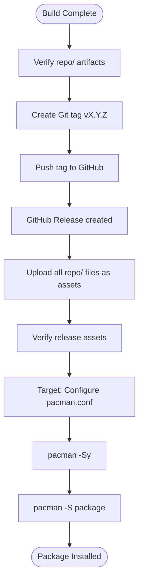

# Release Distribution Flow

## Overview

End-to-end flow for publishing built packages and repository databases to GitHub Releases for consumption by target systems via `pacman`.

## Trigger

- Manual: After successful `bash makepkgs.sh` completion
- Automated: GitHub Actions workflow on tag push (implied)

## Flow Diagram



## Detailed Steps

### 1. Artifact Verification
```bash
# Check all expected artifacts exist
ls repo/*.pkg.tar.zst
ls repo/*.db repo/*.files
```

**Expected Artifacts:**
| Type | Files |
|------|-------|
| Packages | `grub2-theme-nuci-1.0.0-1-x86_64.pkg.tar.zst`, `grub2-theme-nuci-1.0.0-1-i686.pkg.tar.zst`, `hori-fonts-1.5.0-2-any.pkg.tar.zst`, `image-optimiser-1.1.0-1-any.pkg.tar.zst`, `plex-video-optimiser-1.7.0-0-any.pkg.tar.zst` |
| Databases | `hmlendea.db`, `hmlendea.files`, `hmlendea-i686.db`, `hmlendea-i686.files`, `hmlendea-x86_64.db`, `hmlendea-x86_64.files` |

### 2. Git Tag Creation
```bash
# Tag format: v<major>.<minor>.<patch>
# Example: v1.0.0
git tag -a "v1.0.0" -m "Release v1.0.0"
git push origin "v1.0.0"
```

**Tag Strategy:**
- Semantic versioning for repository as a whole
- Single tag covers all packages in the repo
- Tag message describes release highlights

### 3. GitHub Release Creation
Automatic on tag push (if GitHub Actions configured) or manual via GitHub UI:
- Tag: `v1.0.0`
- Title: `Release v1.0.0`
- Description: Changelog or summary
- Assets: All files from `repo/`

### 4. Asset Upload
```bash
# Manual upload via gh CLI
gh release upload "v1.0.0" repo/*.pkg.tar.zst repo/*.db repo/*.files

# Or via GitHub Actions (recommended)
# uses: softprops/action-gh-release@v1
# with:
#   files: repo/*
```

**Assets Uploaded:**
- All `.pkg.tar.zst` package files
- All `.db` and `.files` database files
- No source files or build artifacts

### 5. Target System Configuration

#### pacman.conf Entry
```ini
[hmlendea]
Server = https://github.com/hmlendea/PKGBUILDs/releases/latest/download/
SigLevel = PackageOptional
```

**Key Points:**
- Uses `latest/download/` for always-current release
- `PackageOptional` allows unsigned packages
- No per-architecture server URLs (pacman handles arch selection)

#### Alternative: Specific Release
```ini
[hmlendea]
Server = https://github.com/hmlendea/PKGBUILDs/releases/download/v1.0.0/
SigLevel = PackageOptional
```

### 6. Package Installation (Target System)
```bash
# Sync databases
sudo pacman -Sy

# Search available packages
pacman -Sl hmlendea

# Install package
sudo pacman -S grub2-theme-nuci
sudo pacman -S hori-fonts
sudo pacman -S image-optimiser
sudo pacman -S plex-video-optimiser
```

**Architecture Selection:**
- `pacman` automatically selects correct architecture database
- `any` packages available on all architectures
- `x86_64` packages only on x86_64 systems
- `i686` packages only on i686 systems

## Release Asset Structure

### GitHub Release Assets (Example v1.0.0)
```
Release v1.0.0
├── grub2-theme-nuci-1.0.0-1-i686.pkg.tar.zst
├── grub2-theme-nuci-1.0.0-1-x86_64.pkg.tar.zst
├── hori-fonts-1.5.0-2-any.pkg.tar.zst
├── image-optimiser-1.1.0-1-any.pkg.tar.zst
├── plex-video-optimiser-1.7.0-0-any.pkg.tar.zst
├── hmlendea.db
├── hmlendea.files
├── hmlendea-i686.db
├── hmlendea-i686.files
├── hmlendea-x86_64.db
└── hmlendea-x86_64.files
```

### Download URLs
| Asset | URL Pattern |
|-------|-------------|
| Package | `https://github.com/hmlendea/PKGBUILDs/releases/download/v1.0.0/grub2-theme-nuci-1.0.0-1-x86_64.pkg.tar.zst` |
| Database | `https://github.com/hmlendea/PKGBUILDs/releases/download/v1.0.0/hmlendea.db` |
| Latest | `https://github.com/hmlendea/PKGBUILDs/releases/latest/download/hmlendea.db` |

## Error Scenarios

| Scenario | Impact | Recovery |
|----------|--------|----------|
| Missing package artifact | Architecture unavailable | Rebuild, re-release |
| Missing database | `pacman -Sy` fails | Regenerate, re-release |
| Tag already exists | Push rejected | Delete tag, re-tag |
| Asset upload fails | Incomplete release | Re-upload missing assets |
| `pacman` signature error | Install fails | Use `PackageOptional` or sign packages |
| Network timeout | Download fails | Retry, check connectivity |

## Idempotency

- **Tag creation**: Not idempotent (fails if tag exists)
- **Asset upload**: Idempotent (overwrites existing asset)
- **Release creation**: Not idempotent (fails if release exists)
- **Target install**: Idempotent (pacman handles reinstall)

## Security Considerations

### Current State (Unsigned)
- `SigLevel = PackageOptional` — accepts unsigned packages
- No integrity verification beyond checksums in database
- Suitable for personal/trusted use only

### Recommended: Package Signing
```bash
# Sign packages
gpg --detach-sign *.pkg.tar.zst

# Sign databases
repo-add --sign --key <keyid> database.db.tar.gz package.pkg.tar.zst

# Target system
SigLevel = PackageRequired
# Import public key: pacman-key --add pubkey.gpg && pacman-key --lsign-key <keyid>
```

## Automation (GitHub Actions)

### Suggested Workflow
```yaml
# .github/workflows/release-assets.yml
name: Release Assets
on:
  push:
    tags: ['v*']
jobs:
  release:
    runs-on: ubuntu-latest
    steps:
      - uses: actions/checkout@v4
      - name: Build packages
        run: bash makepkgs.sh
      - name: Create release
        uses: softprops/action-gh-release@v1
        with:
          files: repo/*
```

### Benefits
- Automated build on tag
- Consistent environment
- Automatic asset upload
- Release notes from commits

## Verification Checklist

### Pre-Release
- [ ] All packages build successfully
- [ ] All databases generated
- [ ] `repo-add --verify` passes for all databases
- [ ] `pacman -Si --dbpath repo/` shows correct metadata
- [ ] Tag follows semantic versioning

### Post-Release
- [ ] Release assets match `repo/` contents
- [ ] `pacman -Sy` downloads databases successfully
- [ ] `pacman -Sl hmlendea` lists all packages
- [ ] `pacman -S <package>` installs correctly
- [ ] Installed files match package contents

## Rollback Procedure

```bash
# Delete release and tag
gh release delete "v1.0.0" --yes
git tag -d "v1.0.0"
git push origin --delete "v1.0.0"

# Fix issues, rebuild, re-tag
bash makepkgs.sh
git tag -a "v1.0.1" -m "Release v1.0.1 (fix)"
git push origin "v1.0.1"
```

## Modification Points

| Change | Location |
|--------|----------|
| Change release asset selection | GitHub Actions workflow or `gh release upload` |
| Add signing | `makepkgs.sh` (sign packages) + `repo-add --sign` |
| Change tag format | Release workflow or manual process |
| Add release notes | GitHub Actions `generate-release-notes` or manual |
| Change download URL | `pacman.conf` Server line |
| Add checksums file | Generate `sha256sums.txt` and upload |