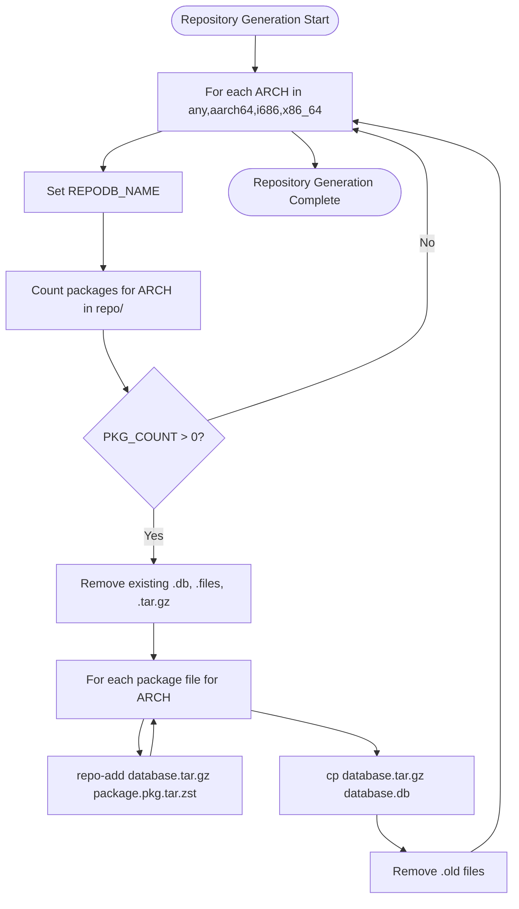

# Repository Generation Flow

## Overview

End-to-end flow for generating per-architecture repository databases from built package artifacts.

## Trigger

- Automatic: After package build loop completes in `makepkgs.sh`
- Manual: Re-run `bash makepkgs.sh` (regenerates from existing artifacts)

## Flow Diagram



## Detailed Steps

### 1. Architecture Iteration
```bash
REPO_NAME="hmlendea"

for ARCH in "any" "aarch64" "i686" "x86_64"; do
    REPODB_NAME="${REPO_NAME}-${ARCH}"
    [ "${ARCH}" == "any" ] && REPODB_NAME="${REPO_NAME}"
    REPODB_PATH="${REPODIR}/${REPODB_NAME}.db"
    # ... process this architecture
done
```

**Database Naming:**
| Architecture | Database Name | Files |
|--------------|---------------|-------|
| `any` | `hmlendea` | `hmlendea.db`, `hmlendea.files` |
| `aarch64` | `hmlendea-aarch64` | `hmlendea-aarch64.db`, `hmlendea-aarch64.files` |
| `i686` | `hmlendea-i686` | `hmlendea-i686.db`, `hmlendea-i686.files` |
| `x86_64` | `hmlendea-x86_64` | `hmlendea-x86_64.db`, `hmlendea-x86_64.files` |

### 2. Package Counting
```bash
PKG_COUNT=$(find "${REPODIR}" -maxdepth 1 -name "*-${ARCH}.pkg.tar.zst" | wc -l)
[ "${PKG_COUNT}" -eq 0 ] && continue
```
- Uses filename suffix to determine architecture
- Skips architecture if no packages exist

### 3. Database Cleanup
```bash
if [ -f "${REPODB_PATH}" ]; then
    rm "${REPODB_PATH}"
    rm "${REPODB_PATH}.tar.gz"
    rm "${REPODIR}/${REPODB_NAME}.files"
    rm "${REPODIR}/${REPODB_NAME}.files.tar.gz"
end
```
Removes all existing database files for clean regeneration.

### 4. Package Registration Loop
```bash
for PKGFILE in ${REPODIR}/*-${ARCH}.pkg.tar.zst; do
    echo "Registering ${PKGFILE} into ${REPODB_NAME}"
    repo-add "${REPODB_PATH}.tar.gz" "${PKGFILE}"
done
```
- Iterates all package files matching architecture suffix
- `repo-add` appends to `.db.tar.gz` and `.files.tar.gz`
- Creates `.old` backup on each invocation

### 5. Database Finalization
```bash
rm "${REPODB_PATH}"
cp "${REPODB_PATH}.tar.gz" "${REPODB_PATH}"
```
- Pacman expects `.db` file (not `.db.tar.gz`)
- Copy preserves the generated database

### 6. Old File Cleanup
```bash
if [ -f "${REPODB_PATH}.tar.gz.old" ]; then
    rm "${REPODB_PATH}.tar.gz.old"
    rm "${REPODIR}/${REPODB_NAME}.files.tar.gz.old"
fi
```
Removes `.old` backups created by `repo-add`.

## Package-to-Database Mapping

| Package Filename Pattern | Target Database |
|-------------------------|-----------------|
| `*-any.pkg.tar.zst` | `hmlendea.db` |
| `*-aarch64.pkg.tar.zst` | `hmlendea-aarch64.db` |
| `*-i686.pkg.tar.zst` | `hmlendea-i686.db` |
| `*-x86_64.pkg.tar.zst` | `hmlendea-x86_64.db` |

**Current Package Distribution:**
| Package | Architectures | Databases |
|---------|---------------|-----------|
| `grub2-theme-nuci` | `x86_64`, `i686` | `hmlendea-x86_64.db`, `hmlendea-i686.db` |
| `hori-fonts` | `any` | `hmlendea.db` |
| `image-optimiser` | `any` | `hmlendea.db` |
| `plex-video-optimiser` | `any` | `hmlendea.db` |

## Error Scenarios

| Scenario | Behaviour | Recovery |
|----------|-----------|----------|
| No packages for architecture | Skipped (continue) | Add packages for that arch |
| `repo-add` fails mid-loop | Partial database, `.old` exists | Delete databases, re-run |
| `cp` finalize fails | `.db.tar.gz` exists, `.db` missing | Manual copy or re-run |
| Disk full | `repo-add` or `cp` fails | Free space, re-run |
| Permission denied | Command fails | Fix permissions |

## Idempotency

- **Fully idempotent**: Re-running produces identical databases from same artifacts
- **No incremental state**: Databases fully regenerated each run
- **Safe to interrupt**: Partial databases cleaned up on next run

## Inputs and Outputs

### Inputs
- `repo/*.pkg.tar.zst` — Built package artifacts
- Architecture determined by filename suffix

### Outputs
- `repo/hmlendea.db` / `repo/hmlendea.files` — Main database
- `repo/hmlendea-aarch64.db` / `repo/hmlendea-aarch64.files`
- `repo/hmlendea-i686.db` / `repo/hmlendea-i686.files`
- `repo/hmlendea-x86_64.db` / `repo/hmlendea-x86_64.files`

## Side Effects

- Removes existing database files
- Creates temporary `.db.tar.gz` and `.files.tar.gz`
- Creates `.old` backups (cleaned up)

## Performance

- **Parallelisation**: None (sequential architecture, sequential package registration)
- **Typical duration**: < 1 second per architecture (few packages)
- **Bottleneck**: `repo-add` per package (minimal)

## Verification

```bash
# Verify database integrity
repo-add --verify repo/hmlendea.db.tar.gz
repo-add --verify repo/hmlendea-x86_64.db.tar.gz

# Query package metadata
pacman -Si --dbpath repo/ grub2-theme-nuci
pacman -Si --dbpath repo/ hori-fonts

# List package files
pacman -Ql --dbpath repo/ image-optimiser
```

## Modification Points

| Change | Location |
|--------|----------|
| Add architecture | `makepkgs.sh` ARCH loop + PKGBUILD arch arrays |
| Change repo name | `makepkgs.sh` REPO_NAME variable |
| Change database format | `repo-add` flags (e.g., `--sign`) |
| Add database validation | After `repo-add` loop |
| Parallelize architectures | Restructure loop (complex) |